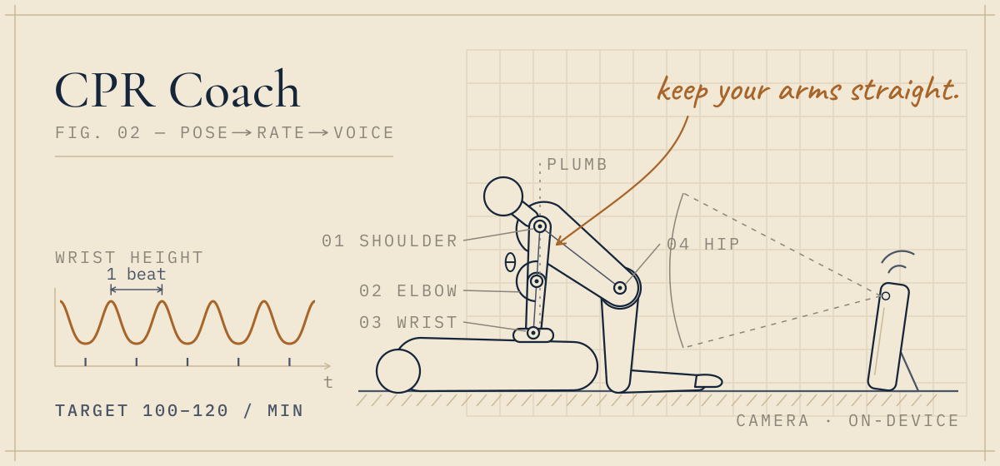
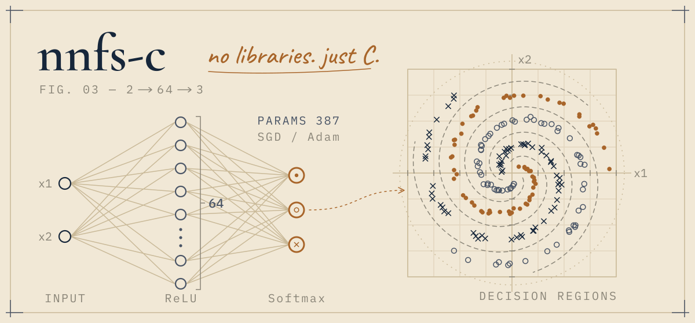
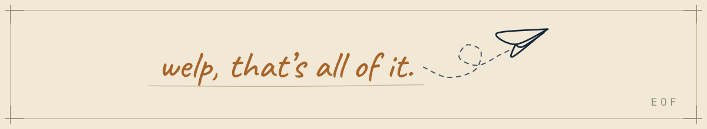

<picture>
  <source media="(prefers-color-scheme: dark)" srcset="assets/hero-dark.svg">
  <source media="(prefers-color-scheme: light)" srcset="assets/hero-light.svg">
  
</picture>

 

<a href="https://github.com/VivekTiwary-25/Itantra">
<picture>
  <source media="(prefers-color-scheme: dark)" srcset="assets/itantra-dark.svg">
  <source media="(prefers-color-scheme: light)" srcset="assets/itantra-light.svg">
  
</picture>
</a>

<a href="https://github.com/VivekTiwary-25/Itantra"><b>iTantra</b></a>: offline voice messages that hop phone to phone over Bluetooth when there's no network. 
SIH 2026

 

<a href="https://github.com/VivekTiwary-25/cpr-coach">
<picture>
  <source media="(prefers-color-scheme: dark)" srcset="assets/cpr-coach-dark.svg">
  <source media="(prefers-color-scheme: light)" srcset="assets/cpr-coach-light.svg">
  
</picture>
</a>

<a href="https://github.com/VivekTiwary-25/cpr-coach"><b>CPR Coach</b></a>: a phone camera that watches your CPR and coaches you out loud, offline, in 10 languages. 
1st place · Anvathon 2026

 

<a href="https://github.com/VivekTiwary-25/nnfs-c">
<picture>
  <source media="(prefers-color-scheme: dark)" srcset="assets/nnfs-c-dark.svg">
  <source media="(prefers-color-scheme: light)" srcset="assets/nnfs-c-light.svg">
  
</picture>
</a>

<a href="https://github.com/VivekTiwary-25/nnfs-c"><b>nnfs-c</b></a>: a neural network library written from scratch in plain C. 
a learning project

 

<b>College stuff</b>

 

- [**4IK25CS243_DAV_LAB**](https://github.com/VivekTiwary-25/4IK25CS243_DAV_LAB): data analysis lab experiments in Python
- [**cdd-lab-H1**](https://github.com/VivekTiwary-25/cdd-lab-H1): collaborative development lab, team exercise
- [**Devops-Lab**](https://github.com/VivekTiwary-25/Devops-Lab): Git practice from the DevOps lab

 

<picture>
  <source media="(prefers-color-scheme: dark)" srcset="assets/signoff-dark.svg">
  <source media="(prefers-color-scheme: light)" srcset="assets/signoff-light.svg">
  
</picture>
